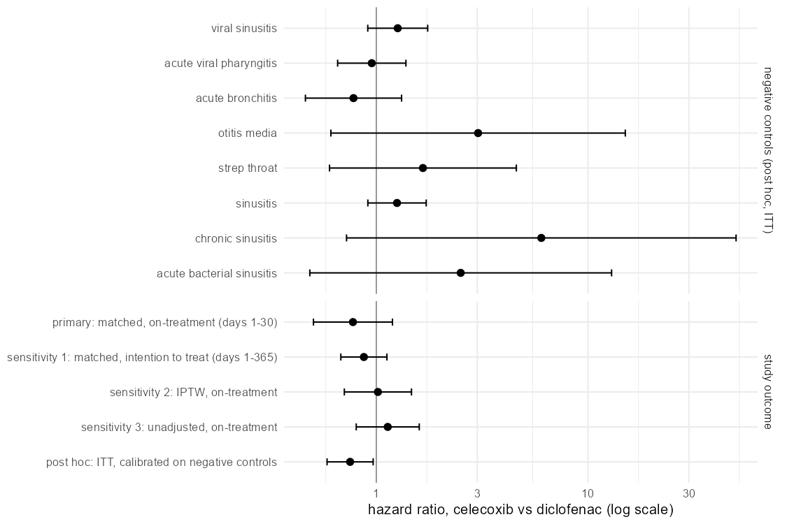

# New users of celecoxib vs diclofenac on the OMOP CDM: a target trial emulation

Real-world evidence studies of a drug or device usually start the same way: write down the trial you would run, define the population, exposures, outcomes and covariates as code sets, build the cohorts from claims or EHR tables, and adjust for the reasons one patient got one treatment and another got the other. This project does that end to end on a public OMOP Common Data Model (CDM) database, the Eunomia GiBleed data from OHDSI, which holds simulated records for 2,694 patients with osteoarthritis who start celecoxib or diclofenac. The question is whether gastrointestinal (GI) bleeding is less common in the 30 days after starting celecoxib.

Cohorts, outcomes and covariates are built in SQL (DuckDB) from the CDM tables, with concept sets resolved through the vocabulary hierarchy, and checked against an independent dplyr build from the raw files. Confounding is handled with an L1-penalized propensity score and 1:1 matching, followed by balance and equipoise diagnostics, a Cox model with pair-clustered variance, the E-value, inverse probability weighting and intention-to-treat sensitivity analyses, and negative control outcomes with empirical calibration. A second part writes the code sets for a claims study of benign prostatic hyperplasia (BPH) procedures, with ICD-10-CM, ICD-10-PCS, CPT and RxNorm codes, and checks every ICD-10 code against the CMS files and every drug against RxNav.

The plan is [docs/design.md](docs/design.md), written before the data were downloaded, and the readout is [docs/readout.md](docs/readout.md). Celecoxib users were twice as likely to have a history of peptic ulcer, and adjusting for it moved the hazard ratio from 1.13 to 0.78 (95% CI 0.50 to 1.19). Weighting instead of matching gave 1.02, so the two pre-registered sensitivity analyses disagree in direction. The pre-registered negative controls had too few events to be used.

```
$ Rscript scripts/08_verdicts.R
  id check                                                            value                        met
1 P1 SQL vs dplyr: cohort, arms, dates, events                        9 of 9 equal                 TRUE
2 P2 matched patients in equipoise (>= 50%)                           94%                          TRUE
3 P3 max |SMD| after matching (< 0.1)                                 0.051                        TRUE
4 P4 negative control CIs excluding 1 (<= 10%)                        0 of 9 controls had 5 events not evaluable
5 P5 primary HR below 1                                               0.78 (0.50-1.19)             TRUE
6 P6 sensitivity 1 and 2 in the same direction                        ITT 0.87, IPTW 1.02          FALSE
7 P7 ICD-10 codes in FY2027 files, RxNorm ingredients in RxNav (100%) 20/20 ICD, 8/8 RxNorm        TRUE
```



## Run

With R 4.4 and the packages duckdb, DBI, dplyr, readr, glmnet, survival, EmpiricalCalibration, ggplot2, jsonlite and testthat. Put the unzipped `GiBleed_5.3` folder from [EunomiaDatasets](https://github.com/OHDSI/EunomiaDatasets/tree/main/datasets/GiBleed) in `data/raw/`, and for Part B the CMS zips `2027-code-descriptions-tabular-order.zip`, `2027-icd-10-pcs-codes-file.zip` and their 2026 versions from the [CMS ICD-10 page](https://www.cms.gov/medicare/coding-billing/icd-10-codes) in `data/raw/cms/`. Then, from the project folder:

```
Rscript scripts/01_load.R
Rscript scripts/02_codesets.R
Rscript scripts/03_cohort.R
Rscript scripts/04_qc.R
Rscript scripts/05_ps.R
Rscript scripts/06_outcomes.R
Rscript scripts/07_figures.R
Rscript scripts/09_bph_codesets.R
Rscript scripts/08_verdicts.R
Rscript -e "testthat::test_dir('tests')"
```

Everything runs in under a minute. `09_bph_codesets.R` calls the RxNav API, so it needs a network connection. The SQL is in `sql/`, the concept sets in `codesets/`, and the tests run the cohort SQL on toy records.

## Data

Eunomia GiBleed, OMOP CDM v5.3, from OHDSI EunomiaDatasets (Apache License 2.0), generated with Synthea; the patients are simulated. ICD-10-CM and ICD-10-PCS code files from the Centers for Medicare & Medicaid Services. RxNorm from the National Library of Medicine through the RxNav API. CPT codes are listed by number with descriptions in my own words. The code is under the MIT license.

Can Zhang, zhan8639@umn.edu
