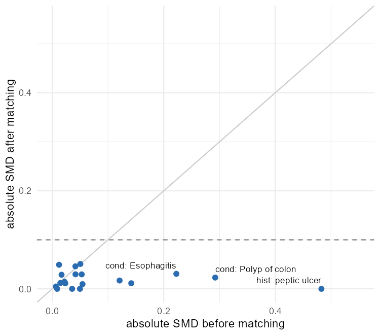

# Readout

The plan is [design.md](design.md). Numbers below come from `results/`, and the data are synthetic, so none of this is evidence about celecoxib or diclofenac.

## Cohort

Every one of the 2,694 simulated patients starts one of the two drugs once. 64 have less than 365 days of observation before that date, which leaves 2,630 new users: 1,800 on celecoxib and 830 on diclofenac (`results/attrition.csv`). No patient is excluded by the other criteria. Each exposure record lasts one day, so the on-treatment window is the 30-day grace period (Amendment 1).

The SQL build and an independent dplyr build from the raw CSV files agree on every patient, arm, index date, outcome date, end of follow-up and event flag (`results/qc_double_programming.csv`).

## Confounding

Celecoxib users were more than twice as likely to have a history of peptic ulcer (36.6% vs 15.9%, standardized mean difference 0.48), and more often had colon polyps and esophagitis in the year before. That is the pattern expected if prescribers keep the COX-2 selective drug for patients at higher GI risk, and it matters here because GI bleeding within 30 days was 10.5% after a peptic ulcer and 4.1% without one.

The propensity model used 19 covariates: 6 pre-specified ones and 13 concepts recorded for at least 1% of patients. Most pre-specified covariates could not be built from this vocabulary, or were recorded for fewer than 10 patients (`results/prespecified_covariates.csv`). Osteoarthritis, the indication, is recorded on the index day for every patient. All 830 diclofenac users found a celecoxib match within the caliper. After matching, the largest absolute standardized difference was 0.05 and peptic ulcer history was exactly balanced. 94% of matched patients had a preference score between 0.3 and 0.7.

## Estimates

| Analysis | HR (95% CI) | Events, celecoxib | Events, diclofenac |
|---|---|---|---|
| Primary: matched, on-treatment (days 1-30) | 0.78 (0.50 to 1.19) | 36 of 830 | 46 of 830 |
| Sensitivity 1: matched, intention to treat (days 1-365) | 0.87 (0.68 to 1.12) | 110 of 830 | 124 of 830 |
| Sensitivity 2: IPTW, on-treatment | 1.02 (0.71 to 1.47) | 113 of 1,800 | 46 of 830 |
| Sensitivity 3: unadjusted, on-treatment | 1.13 (0.80 to 1.60) | 113 of 1,800 | 46 of 830 |

Adjustment moved the estimate from 1.13 to 0.78, in the direction the peptic ulcer imbalance predicts. The confidence interval of the primary estimate includes 1. Its E-value is 1.90: an unmeasured confounder associated with both drug choice and GI bleeding by a risk ratio of 1.9 could explain it away, and one of any strength could move the CI limit across 1, since it already crosses.

The IPTW estimate points the other way. Its weights balanced all covariates (largest weighted difference 0.10), so the gap is more likely about who is compared than about balance: matching keeps all diclofenac users and the celecoxib users who resemble them, so only 132 of the 658 celecoxib users with a peptic ulcer are in the matched cohort, while IPTW reweights both groups to the whole cohort and gives those patients their full share. With 46 diclofenac events, the data cannot separate the two.

## Negative controls

Under the pre-registered rule, a negative control is analyzed only among patients who never had that condition before index. These are common simulated infections, so that rule left almost no one at risk, and no control reached 5 events in the 30-day window (`results/negative_controls.csv`). P4 cannot be evaluated.

Post hoc, I excluded only patients with the condition in the 365 days before index and used the 365-day intention-to-treat window. Eight controls then had at least 5 events (`results/negative_controls_posthoc.csv`), and none of their CIs excludes 1. Their average log hazard ratio was 0.15, slightly toward more events among celecoxib users, and calibrating the intention-to-treat estimate on that null distribution gives 0.75 (0.59 to 0.97). The controls overlap (sinusitis contains viral, chronic and acute bacterial sinusitis), there are only eight, and the rule was chosen after seeing the first one fail, so this is a description, not a result.

## Part B: BPH code sets

All 20 ICD-10-CM and ICD-10-PCS codes in `codesets/bph_spec.csv` exist in the CMS files for fiscal year 2027, and all 20 also exist in fiscal year 2026. Each official description matches the meaning written in the spec before the files were opened. All 8 drug names resolve to RxNorm ingredients in RxNav (`codesets/bph_codesets.csv`). The 13 CPT codes were not checked, because the CPT files are licensed by the AMA.

## Checks

| id | check | value | met |
|---|---|---|---|
| P1 | SQL vs dplyr: cohort, arms, dates, events | 9 of 9 equal | yes |
| P2 | matched patients in equipoise (at least 50%) | 94% | yes |
| P3 | max absolute SMD after matching (below 0.1) | 0.051 | yes |
| P4 | negative control CIs excluding 1 (at most 10%) | no control had 5 events | not evaluable |
| P5 | primary HR below 1 | 0.78 (0.50 to 1.19) | yes |
| P6 | sensitivity 1 and 2 in the same direction | ITT 0.87, IPTW 1.02 | no |
| P7 | ICD-10 codes in the FY2027 files, RxNorm ingredients in RxNav | 20 of 20, 8 of 8 | yes |

## Limits

The patients are simulated, exposure records last one day, and the vocabulary subset lacks most of the comorbidities and co-medications a real study would adjust for, including proton pump inhibitors. The study shows the design and the code, a new-user active-comparator cohort built in SQL on the OMOP CDM with matching, diagnostics and negative controls, not a finding about the drugs.
